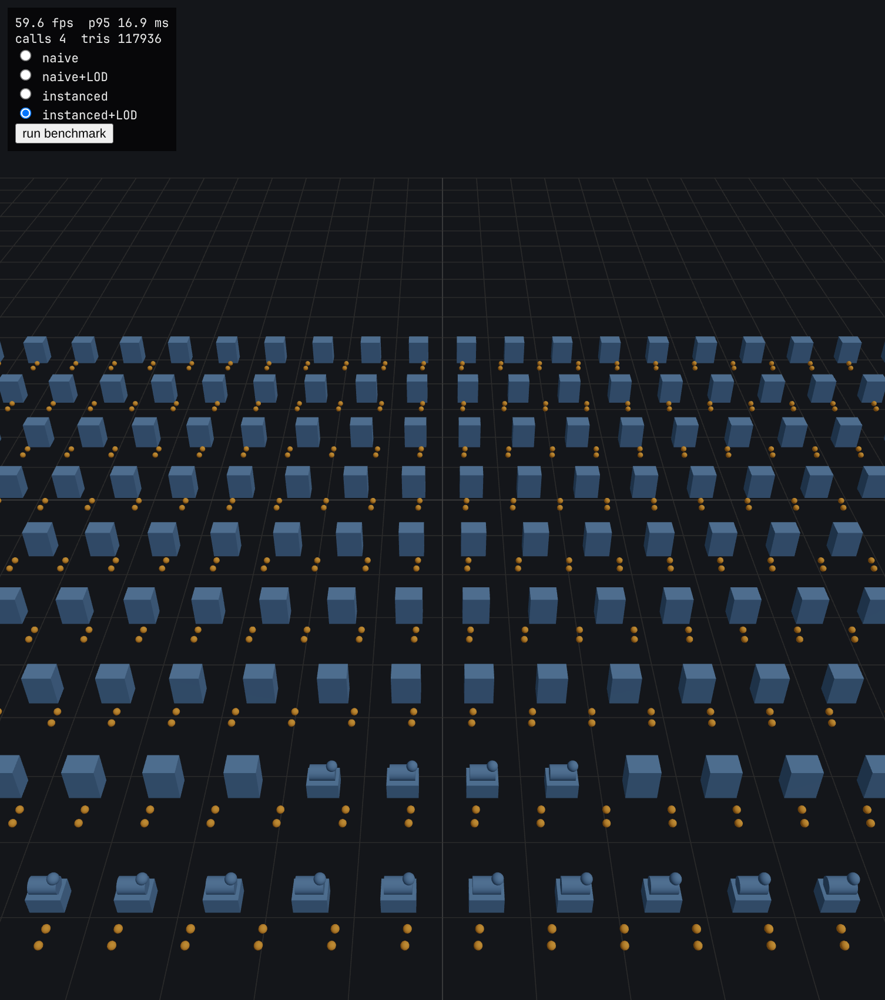

# PL-5 spike: three.js rendering approach

**Result: ADR-0002 stands. React Three Fiber is fine for 200 equipment objects and 500 moving parts.** The recommendation is instanced rendering plus distance-based LOD, with per-frame work kept out of React. The spike took well under the 3-day time box.

Prototype: `spikes/pl-5-rendering/` (throwaway; nothing in `apps/` or `packages/` imports it).

## What was built

- 200 pieces of equipment (about 1.5k triangles each, standing in for a real model) in a 20 x 10 grid, 5 m pitch.
- 500 parts (320-triangle icospheres) circulating on 10 conveyor loops.
- Four configurations, switchable on screen: naive meshes, naive + LOD, `InstancedMesh`, `InstancedMesh` + LOD.
- LOD swaps a 1.5k-triangle machine for a 12-triangle box beyond 45 m from the camera.
- Part motion is driven by timestamped segments `{t0, t1, from, to}`, the stand-in for ADR-0008 events. The renderer keeps its own clock and interpolates (`src/tracks.ts`, unit tested).
- `?x=N` scales both counts N times to find headroom. All meshes have frustum culling off, so every count is a worst case with everything on screen.

## Measurements

Machine: i9-9880H (thin laptop chassis, so thermal throttling is possible), **Intel UHD 630 (Mesa, via ANGLE)**, Chromium 155, Linux, 1280x800 window, vsync on (60 Hz cap). The browser chose the integrated GPU, so this is a reasonable proxy for a typical work laptop's GPU, but **not** for its CPU. Each run is 5 s after warm-up.



**Target load (x1: 200 equipment + 500 parts):**

| config          | fps  | p95 frame ms | max frame ms | JS update ms | draw calls | triangles |
| --------------- | ---- | ------------ | ------------ | ------------ | ---------- | --------- |
| naive           | 60.0 | 16.9         | 17.3         | 0.24         | 701        | 274,800   |
| naive + LOD     | 60.0 | 16.9         | 17.2         | 0.21         | 701        | 117,936   |
| instanced       | 60.0 | 16.9         | 17.1         | 0.16         | 3          | 274,800   |
| instanced + LOD | 60.0 | 16.8         | 17.1         | 0.17         | 4          | 117,936   |

All four hold the 60 fps vsync cap, well above the 30 fps criterion, so the criterion is met even by the naive approach on integrated graphics. **At x1 every config is vsync-capped (identical 60.0 fps and 16.9 ms), so this table cannot rank the approaches.** All comparisons below come from the headroom runs.

**Headroom (the same four configs at 10x and 20x the target).** Three runs per scale, configs run in reversed order (instanced + LOD first, naive last) to expose thermal drift. Cells show mean fps (min-max over the 3 runs) and the worst max frame time seen in any run.

| scale (equip / parts) | config          | fps, mean (min-max) | mean p95 ms | worst max ms |
| --------------------- | --------------- | ------------------- | ----------- | ------------ |
| x10 (2,000 / 5,000)   | instanced + LOD | 60.0 (60.0-60.0)    | 16.9        | 17.3         |
|                       | naive + LOD     | 59.3 (58.4-60.0)    | 19.7        | 30.1         |
|                       | naive           | 59.8 (59.5-60.0)    | 18.8        | 23.8         |
|                       | instanced       | 48.7 (48.1-49.1)    | 22.2        | 27.9         |
| x20 (4,000 / 10,000)  | instanced + LOD | 50.3 (43.3-59.6)    | 24.9        | 36.7         |
|                       | naive + LOD     | 35.5 (34.8-36.1)    | 34.2        | 43.2         |
|                       | naive           | 32.1 (30.4-35.1)    | 38.7        | 52.1         |
|                       | instanced       | 23.3 (20.8-26.6)    | 51.2        | 61.1         |

One x20 run was discarded and repeated: the renderer produced no frames for about 28 s across three configs (cause not identified; most likely contention for the shared GPU).

### What the numbers say

- **LOD helps most.** It cuts triangles by 57%. In both modes and at both scales the LOD variant is at least as fast, and instanced + LOD is the best config at x20, with the caveat that its spread (43-60 fps) is wide.
- **Instancing alone was slower than naive here** (48.7 vs 59.8 fps at x10, 23.3 vs 32.1 at x20) with identical triangle counts. **The cause was not isolated.** Candidates: more overdraw, because three.js sorts separate opaque meshes front-to-back but a single `InstancedMesh` draws in instance order; or the per-frame matrix upload (partly tested: the final runs skip re-uploading static equipment matrices when the camera has not moved, and that did not change the ranking).
- **Draw calls were not the limiting factor on this machine** (7,001 naive calls still ran at about 60 fps at x10). We did not run a test that isolates triangle count (resolution sweep or fixed-triangle/varying-call runs), so do not read a "triangle-bound" conclusion into this data.
- **JS update cost is small:** about 0.2 ms/frame at x1 and about 1.5 ms at x20 (position interpolation and matrix writes). It excludes GL submit.
- **The LOD distance ignores camera height** (horizontal distance to the machine footprint only). With the default camera at y = 55 this keeps more objects detailed than a true 3D distance would, so it is a worst case. The production renderer should choose its metric deliberately.

### Measurement pitfalls found (worth knowing for future perf work)

1. **Occluded windows are throttled to 1 Hz.** A Chrome window that is not frontmost drops `requestAnimationFrame` to about 1 fps (exact 1017 ms frames). `scripts/measure.mjs` launches its own Chromium with background throttling disabled.
2. **Do not benchmark with vsync off.** Frame times then measure CPU submit time while the GPU queue backs up, which gives absurd medians and multi-second stalls. Measure with vsync on and look at p95 and max frame times, which the tables above include.
3. **Animated instance buffers need `DynamicDrawUsage`** on `instanceMatrix`. Set it in the prototype from the start.

## Recommendation

1. **Instance anything repeated (an argument, not a measurement).** Use one `InstancedMesh` per (equipment type, LOD level) and one for parts, keeping the draw-call budget in the low tens. The case is industry practice and the call count (3-4 vs 701 at the target load), which should lower CPU submit cost and main-thread pressure. The spike did **not** measure this: the test machine's fast CPU hid submit cost, and instancing alone was slower than naive on the GPU here (cause not isolated). Treat it as a hypothesis to confirm on a weaker-CPU machine (rec. 6).
2. **LOD by camera distance, in the same per-frame loop that writes matrices.** Use two or three levels (detailed, box, optionally hidden or a billboard). LOD is the one technique the data clearly supports. Triangle budget: start from about 275k visible triangles at the vsync cap (measured: x1 naive, 60 fps on UHD 630) and, with LOD, about 1.1M at 60 fps (x10 instanced + LOD, measured). Plan for well under that on weaker GPUs, and pick the LOD distance metric deliberately (the spike used horizontal distance only).
3. **Keep per-frame updates out of React.** Positions are written in `useFrame` directly into instance matrices from refs. React state is only for editor state (selection, config). The readout in the prototype also updates the DOM directly.
4. **Implement ADR-0008 as segment tracks with a forward-only cursor.** The engine emits movement events `{part, t0, t1, from, to}`. The renderer keeps a per-part cursor into its segment list and interpolates on its own clock (`positionAt`, amortized O(1); it is a cache, not state, so seeking or looping backwards stays correct). Speed changes and animation off then never touch results. Not yet exercised: the spike uses precomputed loop tracks, not streamed engine events, appends to a live track, or seeking.
5. **Do not add GPU picking, post-processing or shadows without re-measuring.** The spike measured none of them, and they can multiply fragment and vertex cost.
6. **Next risk to retire:** rerun on a weaker machine, **including a weaker-CPU laptop** (to test the instancing argument), a UHD 620-class GPU, and in Firefox and Safari. Run the command below there.

ADR-0002 and ADR-0008 need no change in direction. Suggested edits for the lead: record the instancing + LOD recommendation and the budgets above as an ADR-0002 consequence, replace "PL-5 must confirm" with the measured result, and remove the "revisit if PL-5 shows problems" clause.

## Reproduce

```bash
pnpm install && pnpm --filter @factory-sim/spike-pl-5-rendering dev   # terminal 1, serves :5173
cd spikes/pl-5-rendering && node scripts/measure.mjs "http://localhost:5173/?auto=1"                 # terminal 2: markdown table
```

For an interactive view open `http://localhost:5173/`. Append `&x=10` to the measure URL for headroom runs. Set `CHROME=/path/to/chrome` if `chromium` is not on the PATH. CI has no GPU, so there is no fps gate. The non-rendering logic is covered by `pnpm --filter @factory-sim/spike-pl-5-rendering test`.
